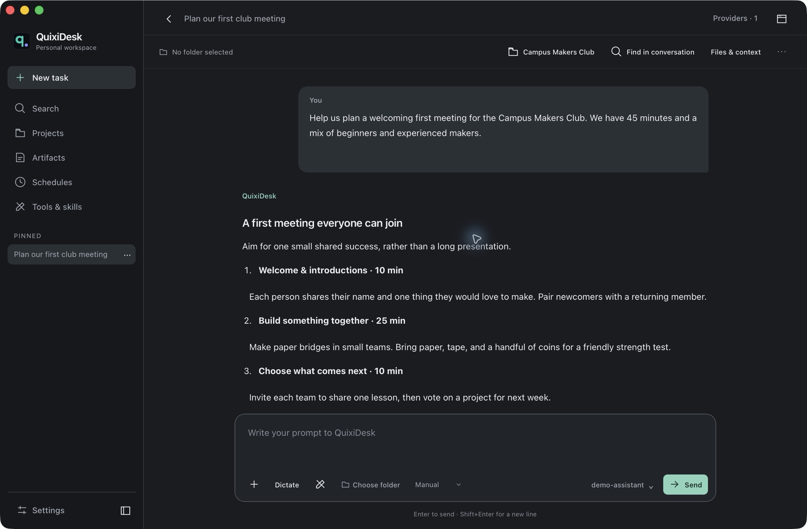
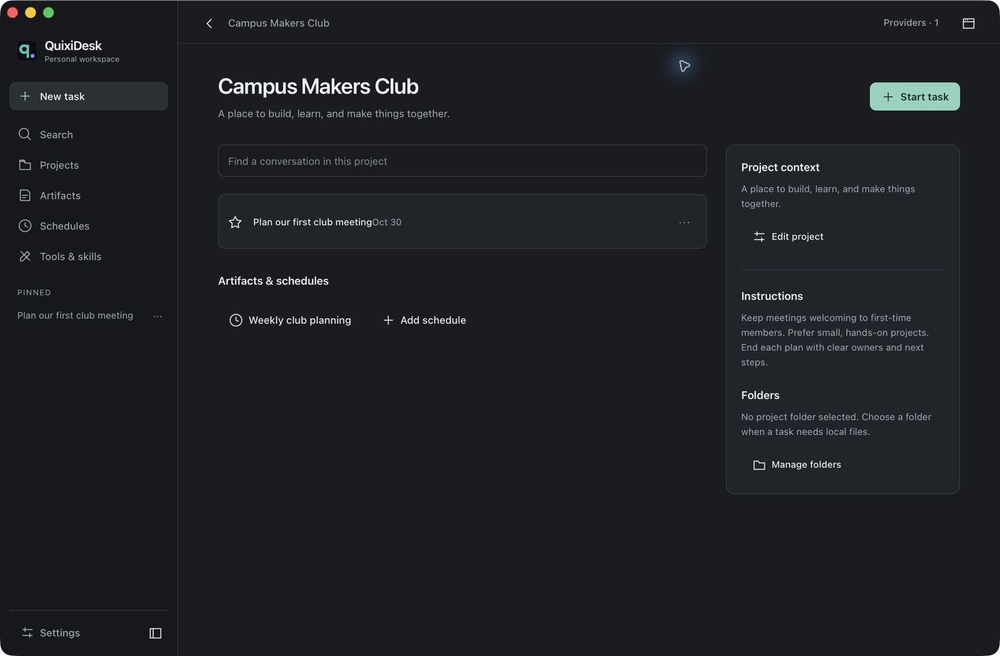

# TsCIDE

**Workspace de desenvolvimento com IA, escrito em Rust, para organizar projetos e trabalhar com arquivos, terminal e Git.**

O **TsCIDE** reúne conversas com diferentes modelos, projetos locais, ferramentas MCP e artefatos HTML em um aplicativo de desktop, sem Electron. Você conecta um provedor de IA — incluindo RunPod Serverless — e autoriza as ações que podem ser executadas no seu projeto. O suporte ao **ChromeOS funciona pelo ambiente Linux (Crostini)** e permanece experimental; também há código para Linux, Windows e macOS.

[](LICENSE)
[](Cargo.toml)

> Este repositório se chama **tscdesk** e deriva do QuixiDesk. Os nomes internos dos crates, o executável `QuixiDesk` e o diretório de dados `~/.quixi` foram preservados para manter compatibilidade. A identidade visual, o atalho e a interface usam **TsCIDE**.

## O que este projeto faz, em palavras simples?

Imagine um chat de IA que, **com a sua autorização**, também pode ler uma pasta do computador, ajudar a editar código, executar comandos e organizar o resultado em um projeto. Esse é o TSCDesk.

Ele é a **interface e o executor de ferramentas**, não um modelo de IA próprio. Você conecta um provedor, escolhe um modelo e conversa. O aplicativo encaminha seus pedidos ao modelo e executa as ferramentas autorizadas que ele solicitar.

Um exemplo:

1. Você escolhe a pasta de um projeto e pede: “Explique este código e proponha uma correção”.
2. O modelo solicita a leitura dos arquivos necessários.
3. O aplicativo mostra as ações e pede aprovação conforme o modo de permissões.
4. Você acompanha a resposta e pode aprovar a edição ou um comando de teste.
5. A conversa e seus resultados ficam salvos localmente.

Também é possível usar apenas o chat, sem selecionar uma pasta. Nesse caso, a conversa não recebe ferramentas de arquivos do workspace.

### Recursos implementados

| Recurso | Para que serve |
| --- | --- |
| Chat com diferentes provedores | Conectar APIs de IA e endpoints compatíveis com OpenAI; receber respostas progressivamente, escolher modelos e manter histórico. |
| Arquivos, terminal e Git | Ler, buscar e editar arquivos, executar comandos e inspecionar alterações no projeto selecionado. |
| Projetos | Reunir pastas, instruções, conversas, artefatos e agendamentos. |
| Artefatos HTML | Criar e visualizar páginas/resultados interativos, consultar revisões e exportar HTML para um arquivo local. |
| MCP e skills | Conectar ferramentas externas e usar instruções especializadas para tarefas. MCP é um protocolo de integração de ferramentas; não é um modelo de IA. |
| Subagentes | Delegar partes delimitadas de uma tarefa, com histórico separado e as permissões da conversa principal. |
| Agendamentos | Preparar tarefas recorrentes. **O aplicativo precisa permanecer aberto** para executá-las. |
| Navegador interno | Consultar páginas em uma área isolada dentro do aplicativo. Não equivale ao Chrome e não usa automaticamente suas abas ou sessões do navegador. |
| Ferramentas de desktop | Captura, clipboard, seleção de pastas e entrada de teclado/mouse, dependendo do sistema, compositor e permissões. Não há paridade garantida entre plataformas. |

**O que ele não faz:** não inclui um modelo treinado próprio, não elimina os custos de uma API, não sincroniza automaticamente seus projetos com a nuvem e não fornece controle irrestrito do ChromeOS. Anexos diretos aceitam imagens e texto; PDF e documentos Office não têm ingestão nativa pelo campo de anexos.

O aplicativo é escrito em **Rust**, usando `tao` para a janela e `wry` para a webview do sistema: GTK 3 + WebKitGTK no Linux, WKWebView no macOS e WebView2 no Windows. **Não exige Electron nem Node.js para executar.** A interface utiliza HTML, CSS e JavaScript incluídos em `resources/`.

## Início rápido no ChromeOS

1. Ative **Configurações → Sobre o ChromeOS → Desenvolvedores → Ambiente para desenvolvedores do Linux**.
2. Abra o aplicativo **Terminal → Linux** do Chromebook.
3. Na primeira instalação, execute:

```bash
sudo apt-get update
sudo apt-get install git python3
cd "$HOME"
git clone https://github.com/andrebauru/tscdesk.git
cd tscdesk
bash iniciar-chromeos.sh
```

Se você já tem o projeto, não repita o clone: consulte [como atualizar](#como-atualizar-no-chromeos). O script **`iniciar-chromeos.sh` fica na raiz**, pede autorização para instalar dependências, compila o aplicativo e o abre. Não execute o script inteiro com `sudo`. A primeira compilação pode demorar e precisa de vários gigabytes livres; veja os [requisitos e opções de instalação](#instalação-no-chromebook-ou-linux-debianubuntu).

Depois de instalar:

- Abra o Launcher do ChromeOS, encontre **TsCIDE**, clique com o botão direito e selecione **Fixar na estante**. Depois disso, basta usar o ícone: o ChromeOS inicia o ambiente Linux automaticamente, sem abrir nem manter uma janela do Terminal.
- Como alternativa para diagnóstico, execute `"$HOME/.local/bin/tscdesk"` no Terminal.
- Entre em **Settings → Providers**, configure o provedor e escolha o modelo. Para RunPod, informe Endpoint ID, API Key e modelo conforme o [guia abaixo](#runpod-serverless-queue-based).
- Selecione uma pasta de projeto para tarefas com arquivos e comece em modo **Manual**. O RunPod atual é chat-only, sem ferramentas de edição/terminal habilitadas.
- Envie `FINAL` isoladamente para pausar a IA e `INICIAR` para permitir novos pedidos. A IDE continua aberta; isso não é um comando de desligamento da GPU.

O script **não configura abertura automática ao ligar ou entrar no ChromeOS**. Ele automatiza a instalação inicial e a abertura quando você o executa.

## ChromeOS: como funciona o suporte

O TSCDesk roda **como aplicativo Linux dentro do Crostini**, o ambiente Linux oferecido pelo ChromeOS. Não é extensão do Chrome, PWA, APK nem um aplicativo executado diretamente no sistema hospedeiro.

- Use o ambiente Debian do app **Terminal** do Chromebook; não é necessário ativar o modo desenvolvedor do dispositivo.
- O instalador e a reinstalação publicam um atalho gráfico com `Terminal=false`. Ao abrir o **TsCIDE** pelo Launcher ou pela estante, o ChromeOS inicia o Crostini automaticamente; não é preciso abrir o Terminal antes nem deixá-lo em execução.
- A VM e o contêiner Linux continuam necessários enquanto o aplicativo estiver aberto e consomem recursos próprios. Eles podem ser encerrados pelo menu do aplicativo Terminal com **Desligar Linux** quando nenhum aplicativo Linux estiver em uso.
- A janela utiliza a integração gráfica existente do Crostini (Sommelier, Wayland ou XWayland). O launcher não substitui as variáveis gráficas da sessão.
- Os arquivos do ambiente Linux ficam disponíveis normalmente. Para acessar uma pasta do ChromeOS, abra o app **Arquivos**, clique nela com o botão direito e escolha **Compartilhar com Linux**. As pastas compartilhadas aparecem sob `/mnt/chromeos`.
- O instalador não configura controle privilegiado de entrada, não altera `/dev/uinput` e não desativa o sandbox do WebKit.
- Capturar/controlar toda a tela do ChromeOS, automatizar apps Android ou controlar o Chrome do sistema **não são funcionalidades garantidas** pelo container Linux.
- Ao sair da conta ou desligar o ambiente Linux, os processos param. Agendamentos não continuam executando fora desse ambiente.

**Estado da validação:** o suporte específico ao ChromeOS é experimental. Testes de scripts com fixtures não substituem um teste real da janela, do cofre de credenciais e das permissões em um Chromebook. ARM64 também precisa de validação em hardware; o build é nativo, não um pacote x86 que funciona em qualquer arquitetura.

## Instalação no Chromebook ou Linux Debian/Ubuntu

### 1. Preparar o ambiente Linux

No Chromebook, abra **Configurações → Sobre o ChromeOS → Desenvolvedores → Ambiente para desenvolvedores do Linux → Configurar**. Em dispositivos administrados, a opção pode estar bloqueada pela escola ou empresa.

No Terminal Linux:

```bash
sudo apt-get update
sudo apt-get install git python3
cd "$HOME"
git clone https://github.com/andrebauru/tscdesk.git
cd tscdesk
```

Mantenha o checkout no armazenamento Linux (`$HOME`), não em uma pasta compartilhada do ChromeOS: a compilação gera muitos arquivos e depende de permissões e links do sistema Linux.

### 2. Instalar e abrir pelo arquivo da raiz

O arquivo **[`iniciar-chromeos.sh`](iniciar-chromeos.sh)** instala na primeira execução e abre a IDE. Nas seguintes, reutiliza a instalação sem recompilar. Execute no Terminal Linux, não como root:

```bash
bash iniciar-chromeos.sh --help
bash iniciar-chromeos.sh

# Instalar/atualizar explicitamente após alterações no código:
bash iniciar-chromeos.sh --instalar

# Reinstalar e remover versões anteriores gerenciadas, preservando ~/.quixi:
bash iniciar-chromeos.sh --reinstalar

# Instalar sem abrir, ou abrir automaticamente sem perguntar:
bash iniciar-chromeos.sh --nao-abrir
bash iniciar-chromeos.sh --abrir

# Diagnóstico: não instala, não abre a janela e não consulta o RunPod.
bash iniciar-chromeos.sh --check
```

Execute esses comandos no Terminal Linux do ChromeOS, normalmente conectado ao contêiner Crostini chamado `penguin`. O nome não é imposto pelo script, portanto contêineres renomeados também funcionam.

O script não configura início no login do ChromeOS e não cria tarefas de aquecimento de GPU. Em um Crostini novo, a primeira execução instala inclusive Python, compiladores, GTK/WebKit e Rust; pode levar bastante tempo e somente depois dela a janela abre. Leia os scripts antes de executá-los. Para apenas instalar, sem abrir:

```bash
bash scripts/install-linux.sh --help
bash scripts/install-linux.sh
```

O instalador foi pensado para **Debian 12+ e Ubuntu 22.04+**, com arquitetura **x86_64 ou aarch64/ARM64** e pacotes GTK 3/WebKitGTK 4.1 disponíveis. Ele:

1. Pede confirmação para instalar dependências via APT; somente essa etapa utiliza `sudo`.
2. Instala ou atualiza Rust stable com sua confirmação, baixando o instalador oficial via HTTPS quando necessário; preserva o toolchain padrão e não compila como root.
3. Compila o workspace usando `Cargo.lock` (`--locked`). Por padrão usa dois jobs para limitar o uso de memória.
4. Instala executáveis, helpers, recursos e licença sob `~/.local/opt/tscdesk`.
5. Cria o comando `~/.local/bin/tscdesk` e o atalho **TSCDesk** no menu de aplicativos Linux/ChromeOS.

**A primeira compilação pode demorar e consumir vários gigabytes.** Reserve, como margem prática, cerca de 10 GB livres; 8 GB de RAM são recomendáveis, mas o consumo varia por máquina e toolchain. Em aparelhos com pouca memória, use um job:

```bash
bash scripts/install-linux.sh --jobs 1
```

Outras opções:

```bash
# Aceitar as etapas de instalação sem perguntas; leia o script antes.
bash scripts/install-linux.sh --yes

# Usar dependências já instaladas.
bash scripts/install-linux.sh --skip-deps

# Instalar executáveis já compilados em target/release.
bash scripts/install-linux.sh --skip-deps --skip-build

# Escolher um diretório absoluto de instalação próprio.
bash scripts/install-linux.sh --prefix "$HOME/Apps/tscdesk"
```

O instalador reconhece somente instalações que ele gerencia. Conflitos com arquivos/atalhos de outro programa são recusados, em vez de sobrescritos silenciosamente. Atualizações mantêm releases anteriores; **não apagam suas conversas, configurações ou projetos**.

### 3. Abrir o aplicativo

Use o atalho **TsCIDE** no Launcher do ChromeOS. Para mantê-lo na barra inferior, clique com o botão direito no ícone e selecione **Fixar na estante**. O atalho abre a janela diretamente, sem manter um processo de Terminal intermediário.

Para diagnóstico, também é possível executar no Terminal:

```bash
"$HOME/.local/bin/tscdesk"

# Diagnóstico sem abrir a janela:
"$HOME/.local/bin/tscdesk" --check
```

Se `~/.local/bin` já estiver no `PATH`, basta `tscdesk`. A instalação é autocontida: não depende de manter o checkout no mesmo lugar depois de compilar e instalar.

O launcher resolve os recursos junto à instalação, usa sua pasta pessoal como workspace padrão no uso normal e preserva overrides explícitos. Perfis de teste mantêm seu próprio workspace. Se não houver um endereço de D-Bus de sessão, usa `dbus-run-session`; não substitui um barramento existente. Sem `DISPLAY` ou `WAYLAND_DISPLAY`, uma sessão SSH/terminal sem interface gráfica não pode abrir a janela.

### Como atualizar no ChromeOS

Feche o TSCDesk e abra o Terminal Linux. Se o checkout foi criado com o clone acima:

```bash
cd "$HOME/tscdesk"
git pull --ff-only
bash iniciar-chromeos.sh --instalar
```

O `git pull --ff-only` evita criar merges automaticamente. Se houver alterações locais conflitantes ou divergência de histórico, ele pode recusar a atualização: preserve seu trabalho e resolva o conflito antes de reinstalar, sem usar `reset --hard` ou apagar a pasta.

**Apenas baixar o código não atualiza os executáveis instalados**; a opção `--instalar` recompila e publica uma nova instalação local. `--reinstalar` prepara primeiro a nova versão, encerra somente processos executados a partir de releases gerenciadas, troca o release ativo e remove releases anteriores que tenham o marcador do instalador. Os dados em `~/.quixi`, suas chaves e os projetos não são apagados, e a reinstalação não exige recriar a senha mestra. Para investigar problemas de abertura, use `bash iniciar-chromeos.sh --check`.

O instalador também garante uma única linha controlada em `~/.bashrc` e `~/.profile` no Bash (ou no arquivo correspondente do shell detectado):

```bash
export PATH="$HOME/.local/bin:$PATH"
```

Abra um novo Terminal ou execute `source ~/.bashrc`. Confirme com `command -v tscdesk`, que deve apontar para `~/.local/bin/tscdesk`.

### Cofre de credenciais no Crostini

As chaves de provedores são criptografadas com AES-256-GCM. No Linux, a chave de criptografia fica preferencialmente no **Secret Service**, por exemplo GNOME Keyring. O TSCDesk usa uma coleção própria chamada `TSCDesk`, criada pelo backend quando necessário; portanto, não depende da coleção `default`, que pode não existir em sessões mínimas do Crostini. Entradas antigas na coleção padrão continuam legíveis e são migradas sem apagar a original.

O instalador inclui `gnome-keyring`, D-Bus e as ferramentas necessárias. Ao abrir o aplicativo, o launcher tenta iniciar `gnome-keyring-daemon --start --components=secrets` na **mesma sessão D-Bus** do TSCDesk, inclusive quando cria uma sessão privada. Nenhuma senha é passada por comando ou registrada em log. Depois de salvar um provedor, o aplicativo lê a credencial de volta e verifica o arquivo criptografado antes de confirmar o armazenamento persistente.

Se o cofre nativo continuar indisponível ou bloqueado, o formulário do provedor informa que a chave está disponível **apenas nesta sessão** e oferece abrir **Settings → Security**. Nesse cofre alternativo, crie uma senha mestra com pelo menos 12 caracteres. O TSCDesk usa Argon2id para derivar a chave de proteção e AES-256-GCM para criptografar e autenticar uma chave aleatória estável; a senha não é salva. O arquivo `~/.quixi/credentials-master.json` contém somente sal, parâmetros e a chave protegida. É necessário desbloquear esse cofre a cada novo processo do aplicativo. Se a senha for esquecida, as credenciais protegidas apenas por ele não podem ser recuperadas.

O Secret Service continua preferencial. O fallback por senha mestra só é usado quando o cofre do sistema falha; chaves de API e tokens nunca são gravados em texto puro, argumentos de processo ou logs. Para trocar a senha, use **Settings → Security → Replace master password** e informe a senha atual. **Não remova a senha do cofre e não use `QUIXI_TEST_PROFILE` para guardar credenciais reais.**

Para confirmar a persistência, salve o provedor e verifique a mensagem **“persistent credential storage verified”**. Feche completamente o TSCDesk, abra-o novamente e volte a **Settings → Providers**: a chave deve continuar mascarada e o provedor configurado, sem precisar colá-la de novo. Se o cofre local por senha mestra estiver bloqueado, desbloqueie-o na tela **Security**.

### Problemas comuns

| Sintoma | O que verificar |
| --- | --- |
| Não abre janela | Abra pelo Terminal do Chromebook ou pelo menu Linux; confirme sessão gráfica e D-Bus. |
| Pacote WebKit ausente | Use uma distribuição com `libwebkit2gtk-4.1-dev`; apenas WebKitGTK 4.0 não basta. O recurso `linux-body` exige WebKitGTK 2.40+. |
| Build encerrado com `Killed` | Pode ser falta de memória. Feche apps e repita com `--jobs 1`. |
| Tela em branco/erro gráfico | Confira os logs no Terminal e atualize os pacotes. Como teste, execute `GDK_BACKEND=x11 "$HOME/.local/bin/tscdesk"` quando houver XWayland; não desative o sandbox. |
| Credenciais não são salvas | Reinstale/atualize pelo instalador e reabra o TSCDesk para ativar o Secret Service; se a interface indicar “apenas nesta sessão”, configure/desbloqueie o cofre em **Settings → Security**. |
| Pasta do ChromeOS não aparece | Compartilhe-a com Linux no app Arquivos e informe seu caminho sob `/mnt/chromeos`. |
| Controle de mouse/screenshot não funciona | O backend pode não estar disponível no Crostini. Não presuma acesso ao desktop hospedeiro nem tente elevar permissões automaticamente. |

## Primeiro uso: conectar a IA

1. Abra **Settings → Providers**.
2. Configure um provedor/endpoint e sua chave, quando necessária.
3. Salve, atualize o catálogo e escolha um modelo no chat.
4. Escolha uma pasta se a tarefa precisar de arquivos.
5. Comece em modo **Manual** e revise cada ação.

Há integrações para OpenRouter, OpenAI, Anthropic, Gemini, DeepSeek, RunPod Serverless e outros, além de endpoints personalizados compatíveis com OpenAI. Os modelos disponíveis, autenticação, preços e limites dependem de cada serviço; uma assinatura de chat não garante acesso à API.

### RunPod Serverless (Queue-based)

Em **Settings → Providers → RunPod Serverless**, informe **Endpoint ID**, **API Key** e **Modelo** (padrão `qwen2.5-coder:7b`). Use **Salvar** para guardar a configuração no mecanismo criptografado existente; a chave salva não é devolvida à interface. Deixe o campo de chave vazio para preservar a chave existente.

**Testar conexão** consulta `/health`: verifica autenticação/configuração, sem submeter inferência. Um resultado positivo **não comprova que o modelo consegue responder**. O chat usa `https://api.runpod.ai/v2/{Endpoint ID}/run` e acompanha o job por `/status/{Job ID}`, com prazo máximo, espera de fila/cold start e cancelamento quando possível. Não informe uma URL arbitrária no lugar do ID.

A versão atual retorna uma **resposta completa**, sem anunciar streaming nem tool calling neste provedor. O contrato do worker foi verificado no código público, mas a imagem mutável `svenbrnn/runpod-ollama:latest` e seu endpoint ainda precisam de uma inferência real autorizada para validação. Não foram executados testes pagos. Veja o [guia RunPod e limitações](docs/runpod.md).

### Pausar e retomar a IA

Envie **`FINAL`** isoladamente no chat para pausar a IA, interromper os loops locais e tentar cancelar jobs RunPod conhecidos. A IDE fica aberta: editor, arquivos e terminal continuam disponíveis. A pausa é persistida para a próxima abertura.

Envie **`INICIAR`** isoladamente para permitir **novos** pedidos. Isso não repete a tarefa anterior nem inicia GPU sozinho. `FINAL` descarta mensagens pendentes e desarma agendamentos de IA; eles podem ser reativados explicitamente na interface, mas `INICIAR` não os reativa sozinho. Também há um controle visual de pausa/retomada. Maiúsculas/minúsculas e espaços externos são aceitos; frases, código, mensagens citadas ou anexos não acionam esses comandos locais.

`FINAL` **não desliga fisicamente a GPU**. Cancelamento remoto pode falhar ou ficar limitado por uma solicitação já em trânsito; nesses casos a interface informa a limitação. Sem trabalho, o RunPod poderá reduzir os workers a zero conforme a configuração de Scale to Zero. A IDE não altera `Active workers=0`/`Max workers=1`, não aquece o endpoint e não promete custo zero.

Para modelos locais, conecte um servidor como Ollama, LM Studio ou llama.cpp por um endpoint compatível. **O instalador não instala nem baixa modelos.** Um Chromebook com pouca memória pode usar APIs remotas sem executar inferência local. `127.0.0.1` refere-se ao ambiente onde o aplicativo roda; um servidor no hospedeiro ou em outra máquina precisa de um endereço acessível pelo container.

### Permissões e privacidade

- **Manual:** leitura do workspace é permitida; alterações e comandos pedem aprovação.
- **Allow file edits:** permite edições na conversa, mas comandos continuam pedindo aprovação.
- **Auto:** permite ferramentas sem aprovação individual; use apenas com tarefas e pastas confiáveis.
- Aprovações são políticas do aplicativo, **não uma garantia de sandbox do sistema**. O confinamento por Bubblewrap depende da capacidade do ambiente e pode não estar disponível.
- O histórico fica local, mas mensagens, trechos de arquivos e resultados de ferramentas usados na conversa podem ser enviados ao provedor escolhido. Não envie segredos sem revisar o contexto e a política do serviço.
- Os dados normais ficam em `~/.quixi`. Faça backup desse diretório e dos seus projetos. Artefatos locais não são publicados automaticamente.

## Compilação manual e desenvolvimento

No Linux, as dependências principais são `build-essential`, `pkg-config`, `libgtk-3-dev`, `libwebkit2gtk-4.1-dev`, `perl` e Rust stable atual. Para execução, é necessária uma sessão gráfica e D-Bus. O instalador configura o Secret Service para credenciais; quando ele não está disponível, o cofre criptografado por senha mestra pode ser usado.

```bash
cargo build --locked --release --workspace
./target/release/QuixiDesk
```

| Comando | Finalidade |
| --- | --- |
| `make` | Compilar o workspace em release. |
| `make run` | Abrir o aplicativo via Cargo. |
| `make test` | Executar testes Rust; prefira um perfil descartável, como abaixo. |
| `make check` | Verificar todos os targets. |
| `make install-linux` | Executar o instalador Linux/Crostini. |
| `make app` / `make install` | Empacotar/instalar o bundle **macOS**, não o aplicativo Linux. |

### macOS

Instale as ferramentas de linha de comando da Apple e Rust stable. Depois:

```bash
cargo build --locked --release --workspace
./scripts/package-macos-app.sh
open dist/QuixiDesk.app
```

O setup documentado usa macOS 14+. Captura de tela, acessibilidade e AppleScript podem exigir permissões do sistema.

### Windows

Use Windows 11 com Rust MSVC, Visual Studio C++ Build Tools com Windows SDK e WebView2 Evergreen.

#### Instalação fácil

Abra a pasta do projeto no Explorador de Arquivos, clique com o botão direito em uma área vazia e escolha **Abrir no Terminal**. Depois execute:

```powershell
powershell -ExecutionPolicy Bypass -File .\instalar-windows.ps1
```

O script detecta uma instalação nova, pede consentimento e instala somente os pré-requisitos ausentes por canais oficiais: Rustup/Rust stable, Microsoft Visual Studio Build Tools com C++/Windows SDK e WebView2 Evergreen. O Build Tools pode solicitar elevação UAC e ocupar vários gigabytes. Depois, compila a versão release, instala o aplicativo somente para o usuário atual em `%LOCALAPPDATA%\Programs\TSCDesk` e cria atalhos no Desktop e no menu Iniciar.

Na primeira instalação, o script pergunta se deseja abrir o TSCDesk. Pressionar Enter ou responder `N` encerra sem abrir. Em automações, escolha explicitamente `-AbrirAoFinal` ou `-NaoAbrirAoFinal`. Ao executar o instalador novamente sobre uma instalação gerenciada, a próxima abertura solicita uma nova senha mestra; os dados e o cofre anterior são preservados e a troca exige a senha atual.

Para instalar e abrir imediatamente:

```powershell
powershell -ExecutionPolicy Bypass -File .\instalar-windows.ps1 -AbrirAoFinal
```

Opções úteis:

- `-Yes`: aceita previamente a instalação das dependências detectadas; use após revisar o script.
- `-Diagnostico`: apenas informa o estado de Rust, MSVC/Windows SDK e WebView2.
- `-PularDependencias`: não instala dependências; falha claramente se alguma necessária estiver ausente.
- `-PularCompilacao`: reutiliza uma compilação release já existente.
- `-AbrirAoFinal`: abre o aplicativo ao concluir, sem perguntar.
- `-NaoAbrirAoFinal`: conclui sem abrir o aplicativo.
- `-SemAtalhoDesktop`: não cria o atalho no Desktop.
- `-SemAtalhoMenuIniciar`: não cria o atalho no menu Iniciar.
- `-Destino "C:\Apps\TSCDesk"`: escolhe outra pasta de instalação.

Para verificar um computador antes de instalar:

```powershell
powershell -ExecutionPolicy Bypass -File .\instalar-windows.ps1 -Diagnostico
```

O Windows deve ter conexão com a internet e `winget` (App Installer). O script não desativa Smart App Control nem outras proteções do Windows. Se uma política corporativa bloquear executáveis Rust não assinados, a configuração precisa ser tratada pelo administrador da máquina.

#### Compilação manual

Em PowerShell:

```powershell
cargo build --locked --release --workspace
.\target\release\QuixiDesk.exe
```

Para distribuição manual, mantenha os executáveis e `resources/` juntos. `QUIXI_RESOURCES_DIR` seleciona explicitamente os recursos quando necessário.

### Variáveis de ambiente

- `QUIXI_RESOURCES_DIR`: localização dos arquivos em `resources/`.
- `QUIXI_WORKSPACE`: workspace padrão do engine; **não dá acesso de arquivos a uma conversa sem pasta selecionada**.
- `QUIXI_TEST_PROFILE`: perfil isolado para testes, não para uso normal nem para credenciais reais.
- `QUIXI_AUTOMATION_PORT`: porta loopback de automação (normal: 19455; perfil de teste: 19456). Evite conflitos entre instâncias.

### Testes

```bash
# Instalador e launcher, com arquivos simulados: não instala pacotes.
python3 -m unittest discover -s tests/install -v

# Rust, no Linux/macOS, com perfil descartável:
QUIXI_TEST_PROFILE="$(mktemp -d)" cargo test --locked --workspace

# Testes da interface: Node.js é necessário somente nesta etapa.
npm ci --prefix tests/ui
node --test tests/ui/*.test.cjs
python3 scripts/audit-product-assets.py

# Janela real WebKit em Xvfb, após build Linux:
# Requer python3, xvfb, xauth e dbus-run-session.
python3 scripts/test-linux-ui.py
```

Testes do instalador validam a instalação e o launcher, não o funcionamento de modelos ou da GUI. O smoke test Xvfb também não comprova integração com Sommelier nem controle da tela do ChromeOS.

## Estrutura e documentação

```text
tscdesk/
├── crates/quixi-app/         # Janela nativa e ponte com a interface
├── crates/quixi-engine/      # Conversas, provedores, tarefas e permissões
├── crates/quixi-ipc/         # Serviços e eventos da interface
├── crates/quixi-platform/    # Integrações específicas de cada sistema
├── crates/quixi-workspace/   # Arquivos, Git e terminal
├── crates/quixi-mcp/         # Clientes e integrações MCP
├── crates/quixi-proto/       # Tipos compartilhados e caminhos
├── bins/                    # Helpers executáveis
├── resources/               # Interface, ícones, defaults e skills
└── scripts/                 # Instalação, empacotamento e testes
```

- [Checklist de validação em um Chromebook](docs/chromeos.md)
- [Arquitetura](ARCHITECTURE.md)
- [Guia de MCP](docs/mcp.md)
- [Subagentes](docs/subagents.md)
- [Contexto de tarefas](docs/scoped-task-context.md)
- [Plano E2E — não é um runner completo implementado](docs/testing/E2E_TEST_PLAN.md)
- [Ativar Linux no Chromebook — Google](https://support.google.com/chromebook/answer/9145439?hl=pt-BR)
- [Crostini, compartilhamento e limites — Chromium](https://www.chromium.org/chromium-os/developer-library/guides/containers/containers-and-vms/)
- [Dependências e plataformas do Wry](https://github.com/tauri-apps/wry#platform-specific-notes)

### Capturas de tela

As imagens abaixo mostram o QuixiDesk original no macOS, com dados de demonstração. Não são capturas de uma execução no ChromeOS.




## Origem e licença

Baseado no trabalho do QuixiDesk; mantidos os avisos e a [licença MIT](LICENSE). O desenvolvimento original também reconhece a contribuição do [REA — Reverse Engineer Anything](https://github.com/morluto/rea). Recursos e dependências redistribuídos mantêm seus próprios avisos e licenças em `resources/licenses/`, `resources/artifact-libs/licenses/` e `vendor/`.
